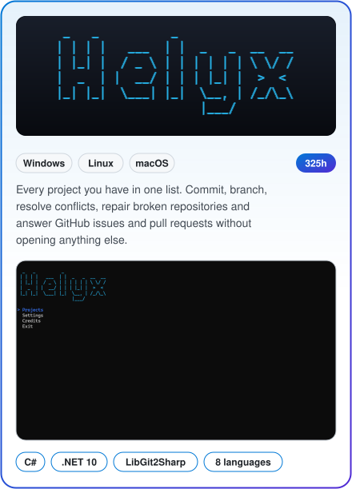
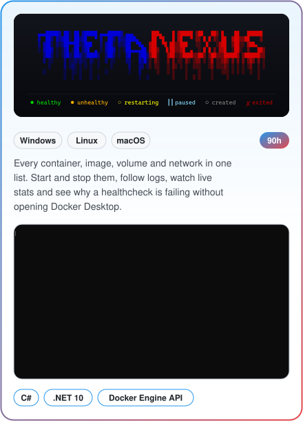
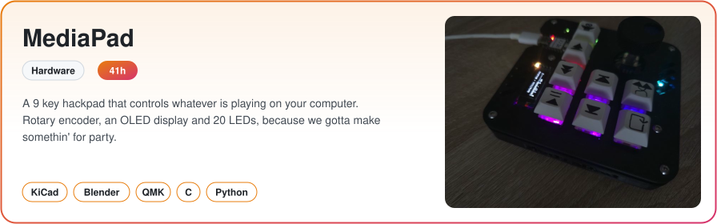

**Developer. I build things I'd actually use myself, and then I can't stop adding to them.**

## About me

I'm a developer. Mostly C#, but I pick whatever the thing needs.
I started with one project manager for my own repos and it kind of got out of hand.

Most of this was built during [Stardance](https://stardance.hackclub.com/@lix/projects) by Hack Club.

## Things I made

<a href="https://github.com/lixtheyt/Helyx"><picture><source media="(prefers-color-scheme: dark)" srcset="assets/helyx-dark.svg"></picture></a>
<a href="https://github.com/lixtheyt/ThetaNexus"><picture><source media="(prefers-color-scheme: dark)" srcset="assets/thetanexus-dark.svg"></picture></a>

<a href="https://github.com/lixtheyt/mediapad"><picture><source media="(prefers-color-scheme: dark)" srcset="assets/mediapad-dark.svg"></picture></a>

## Wanna work on (for future Hack Club Event)

- **TauTUI** – something like Trello, but in your terminal. Boards you can keep offline or share with friends.
- **ZetaPrime** – btop in C#.
- **OmicronBridge** – a P2P file sender.

## What I work with

**Languages**

**Frameworks and libraries**

**Systems**

**Editors**

**Tools**

**I ship for**

**Hardware and design**

## Commits

<picture><source media="(prefers-color-scheme: dark)" srcset="https://streak-stats.demolab.com?user=lixtheyt&theme=dark&hide_border=true&background=0D1117&ring=0078D6&fire=512BD4&currStreakLabel=0078D6&sideLabels=E6EDF3&dates=8B949E"></picture>

<picture><source media="(prefers-color-scheme: dark)" srcset="https://github-profile-summary-cards.vercel.app/api/cards/profile-details?username=lixtheyt&theme=github_dark"></picture>

<picture><source media="(prefers-color-scheme: dark)" srcset="https://github-profile-summary-cards.vercel.app/api/cards/stats?username=lixtheyt&theme=github_dark"></picture>
<picture><source media="(prefers-color-scheme: dark)" srcset="https://github-profile-summary-cards.vercel.app/api/cards/most-commit-language?username=lixtheyt&theme=github_dark"></picture>

